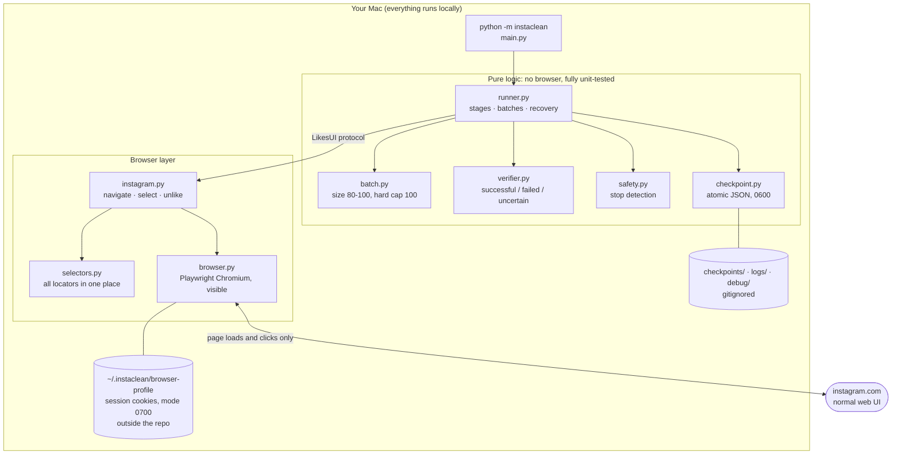
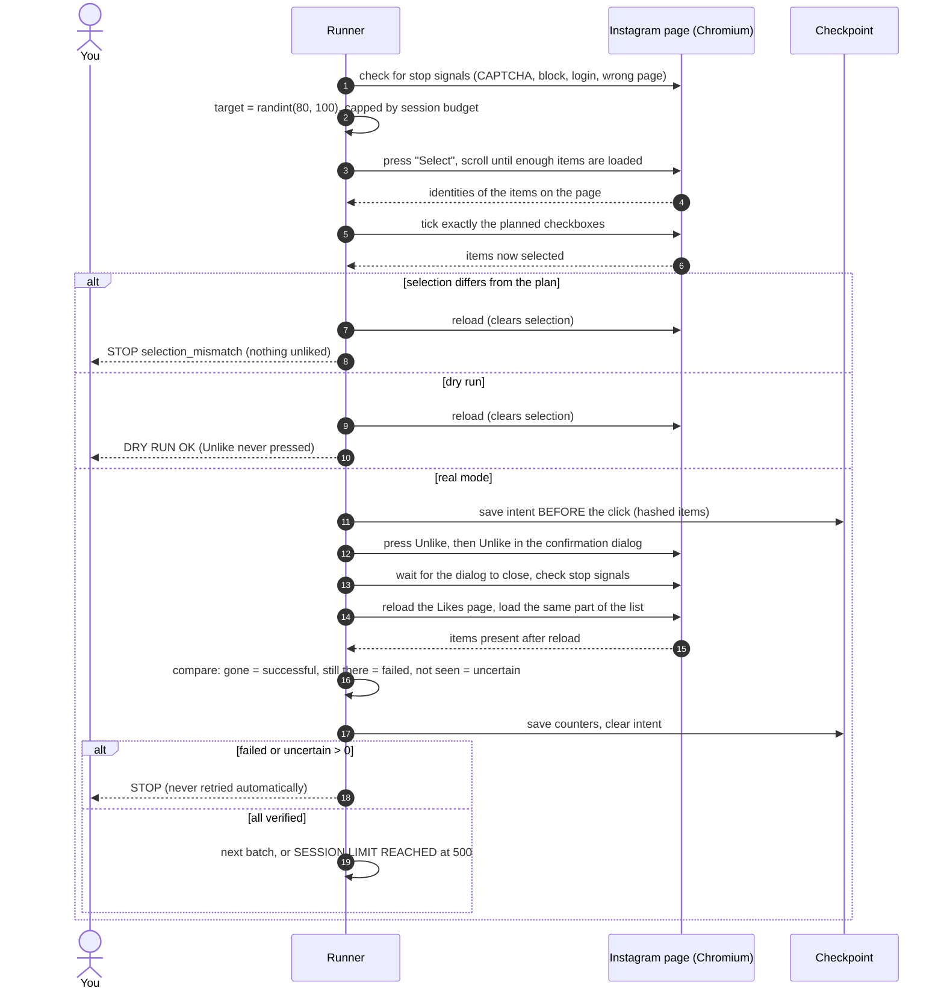
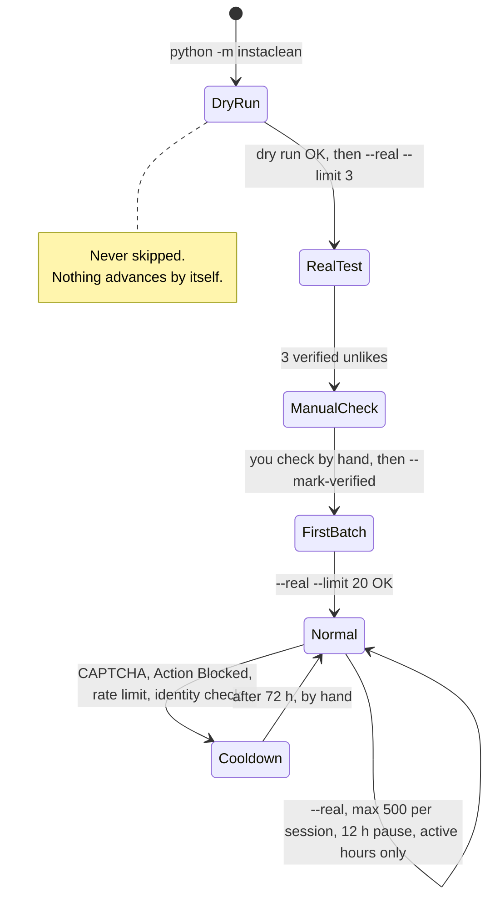
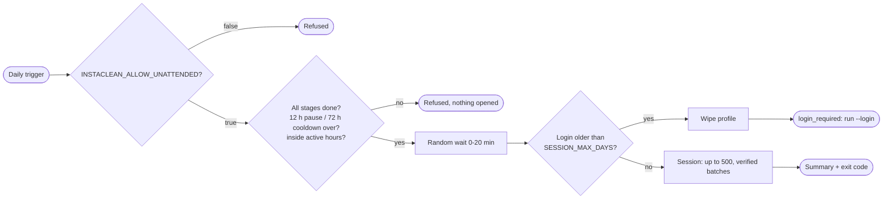
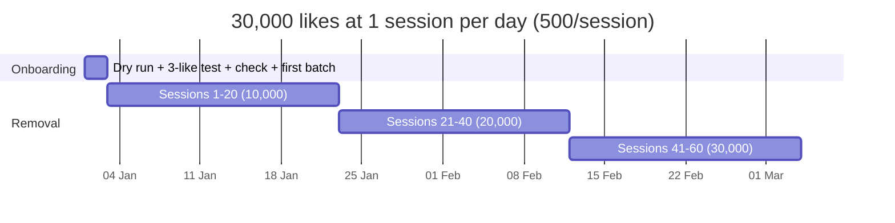
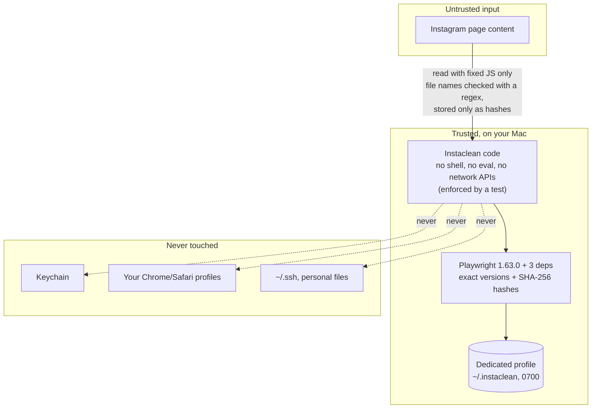

# Instaclean

**Remove your own Instagram likes in bulk, locally, through Instagram's normal web interface.**

Instaclean opens a visible Chromium window, lets *you* log in, goes to
*Your activity → Interactions → Likes*, selects a batch of liked posts, presses
**Unlike**, then reloads the page and **checks that every item is really gone**
before doing anything else. If something looks wrong, it stops.

[](#install)
[](#security-model)
[](#the-safe-path-five-steps)
[](LICENSE)

> Italian step-by-step guide: [docs/GUIDA-IT.md](docs/GUIDA-IT.md) ·
> Architecture: [docs/ARCHITECTURE.md](docs/ARCHITECTURE.md) ·
> Security: [docs/SECURITY.md](docs/SECURITY.md)

> [!WARNING]
> **No tool can promise your account will not be restricted.** Instagram does not
> publish its limits, and using automation can lead to temporary blocks or other
> restrictions. Instaclean does not hide that it is automated (no stealth tricks, no fake
> fingerprints). It only keeps sessions at the hours you would normally be on Instagram.
> Its approach is to do less, verify everything and **stop at the first sign of trouble**.
> Use it on your own account, at your own risk.

---

## Contents

- [What it does and does not do](#what-it-does-and-does-not-do)
- [How it works](#how-it-works)
- [Install](#install)
- [The safe path: five steps](#the-safe-path-five-steps)
- [Options: window, posts or reels, login lifetime](#options)
- [Running it every day on its own](#running-it-every-day)
- [How long does it take? (e.g. 30,000 likes)](#how-long-does-it-take)
- [Account safety: what Instaclean does about blocks](#account-safety)
- [Best practices](#best-practices)
- [Security model](#security-model)
- [Configuration](#configuration)
- [Commands](#commands)
- [Troubleshooting](#troubleshooting)
- [Development and tests](#development-and-tests)
- [Known limitations](#known-limitations)

---

## What it does and does not do

| ✅ Does | ❌ Never does |
|---|---|
| Uses the normal Instagram website in a visible browser | Call private/internal Instagram APIs or send its own HTTP requests |
| Lets you log in and do 2FA by hand | Ask for, store or type your password |
| Keeps the session in a dedicated browser profile on your Mac | Read, export or log cookies/tokens; touch your Chrome/Safari profile or Keychain |
| Verifies every batch after a reload | Count a click as a success |
| Stops on CAPTCHA, Action Blocked, rate limits, login or identity checks | Solve CAPTCHAs, bypass limits, use "stealth" tricks or fake fingerprints |
| Pauses between sessions and after any block; starts real sessions only in morning, mid-morning and evening windows | Run in the background, schedule itself, or retry an uncertain unlike |
| Starts in **dry run** | Switch to real mode on its own |

---

## How it works

### Components



### One batch, step by step



### How a batch result is decided


### Stages: real mode is unlocked step by step



### Crash recovery


---

## Install

**Requirements:** macOS (Apple Silicon or Intel) · Python **3.11+** (tested with 3.14.6) ·
about 600 MB of disk for Playwright's Chromium · **no macOS permissions needed**
(no Accessibility, no Screen Recording, no Full Disk Access).

```bash
git clone https://github.com/Mr-Hodler/Instaclean.git
cd Instaclean

# 1. isolated environment (uv recommended: brew install uv)
uv venv .venv --python 3.14

# 2. dependencies, refused if any file differs from the reviewed hashes
uv pip install --python .venv/bin/python --require-hashes \
    -r requirements.lock -r requirements-dev.lock

# 3. Playwright's own Chromium (one-time download from Microsoft's CDN)
.venv/bin/playwright install chromium

# 4. check everything
.venv/bin/python -m instaclean --doctor
```

Without `uv`: `python3 -m venv .venv && .venv/bin/pip install --require-hashes -r requirements.lock -r requirements-dev.lock`.

`--doctor` only reads: Python version, virtualenv, package versions compared
with the lock file, the Chromium install, profile and folder permissions,
`.env`, `.gitignore`, stages and cooldown. It changes nothing.

---

## The safe path: five steps

| # | Command | What happens | Unlocks |
|---|---|---|---|
| 1 | `python -m instaclean` | **Dry run.** Log in by hand, navigate, select one batch, verify the selection, reload to cancel. **Unlike is never pressed.** | step 2 |
| 2 | set `INSTACLEAN_DRY_RUN=false` in `.env`, then `python -m instaclean --real --limit 3` | Type `UNLIKE` to confirm. Removes **3** likes and verifies them. | step 3 |
| 3 | check on your phone, then `python -m instaclean --mark-verified` | You confirm those 3 posts are no longer liked and nothing else changed. | step 4 |
| 4 | `python -m instaclean --real --limit 20` | First small batch. | step 5 |
| 5 | `python -m instaclean --real` | Normal mode: batches of 80–100, **max 500 per session**, then exits. | — |

(`python` = `.venv/bin/python`.) Real mode needs **two** switches: `INSTACLEAN_DRY_RUN=false`
in `.env` **and** `--real` on the command line. Either one alone gives you a dry run or a refusal.

---

## Options

### Browser window

| `INSTACLEAN_BROWSER` | What you see | Notes |
|---|---|---|
| `visible` (default) | a normal Chromium window | needed for the very first login and for the 5 setup steps |
| `background` | the window is minimized right after start | you can restore it from the Dock at any time; same browser as `visible` |
| `headless` | no window at all | Instagram can see the browser is headless (`HeadlessChrome`): nothing is disguised, so it may treat it more strictly. If the login has expired, a headless run stops with `login_required` instead of waiting |

Tested on a real account (2026-10-19): `visible`, `background` and `headless` all
loaded, selected and verified a full batch in dry run.

### Posts or reels

| `INSTACLEAN_CONTENT` | Removes likes on |
|---|---|
| `all` (default) | everything on the Likes page |
| `posts` | photos and carousels only |
| `reels` | videos (reels) only |

The type comes from the label Instagram puts on each tile ("Photo", "Carousel…",
"Video"). Only the part before the first comma is read, so the author is never read or stored.
Tiles whose type isn't recognised are skipped unless the setting is `all`.
`posts` is slower at the start of each batch when most of your likes are reels: it has to
scroll further to collect 80–100 posts (measured: ~55 s instead of ~13 s).

### Login lifetime (local logout)

| Setting | Default | Effect |
|---|---|---|
| `INSTACLEAN_SESSION_MAX_DAYS` | `14` | when the login on this Mac is older than this, the dedicated profile is wiped before the next run and you log in again (`0` = never expire) |
| `INSTACLEAN_WIPE_PROFILE_AFTER_RUN` | `false` | wipe the profile after **every** run: nothing stays on disk, but you log in every time, so it can't be used for unattended runs |

```bash
.venv/bin/python -m instaclean --login    # visible window: log in by hand (2FA too), then it closes
.venv/bin/python -m instaclean --logout   # wipe the profile now
```

Wiping the profile logs **this Mac** out. To end the session on Instagram's side as well,
use *Settings → Accounts Center → Password and security → Where you're logged in*.
Password saving and autofill are switched off in the profile, so your password is never
written to disk, even when you log in by hand.

---

## Running it every day

After the five setup steps, normal sessions can run without you typing `UNLIKE`:

1. In `.env`: `INSTACLEAN_ALLOW_UNATTENDED=true` (this is the switch; `false` turns it off).
2. Command: `.venv/bin/python -m instaclean --real --unattended`
3. Schedule it with anything that runs a command. With the Claude desktop app, a scheduled
   task can run it, read the result and tell you if it stopped.

**When to schedule it: three times a day, inside the active hours.** A trigger at noon and
another at midnight is a pattern no person has. Schedule it in the morning, mid-morning and
evening instead (for example 07:40, 10:40 and 20:40, cron `40 7,10,20 * * *`) and let the
12 h pause decide which of them actually runs:

| Day | 07:40 | 10:40 | 20:40 |
|---|---|---|---|
| 1 | **runs** (ends ~08:10) | pause | **runs** (ends ~21:10) |
| 2 | pause (until ~09:10) | **runs** (ends ~11:10) | pause (until ~23:10) |
| 3 | **runs** | pause | **runs** |

So the start time changes from day to day, never falls at night, and averages about
1.5 sessions (~750 likes) a day. If you prefer one session a day, schedule a single trigger
inside one window. Unattended runs also wait a random 0–20 min before starting
(`INSTACLEAN_START_JITTER_MINUTES`), because a scheduler fires at the same minute every day.



**What the Mac needs while it runs (~7–15 min a day):**

| | Needed? |
|---|---|
| Mac switched on and **not asleep** | yes. A sleeping Mac runs nothing; use `caffeinate -i` around the command to stop idle sleep during the run |
| You logged in to macOS | yes (the browser runs in your user session). The screen can be locked |
| Internet | yes, your usual connection |
| The scheduler running | yes. The Claude app's scheduled tasks need the app open; if it was closed, the task runs when the app opens again |
| A visible window | no, with `background` or `headless` |

Unattended runs never use `--limit`, never skip the stages, pauses or cooldowns, and stop
exactly like attended ones.

---

## How long does it take?

**Short answer for 30,000 likes: about 60 sessions of 500, so roughly one to two months on
the calendar, and 10–15 hours of the program actually running.** What limits it is the
pacing between sessions, not how fast the clicks are.

### The numbers

| Quantity | Value | Notes |
|---|---|---|
| Likes per session | 500 (default cap) | `INSTACLEAN_MAX_ACTIONS_PER_SESSION` |
| Batches per session | ~6 | 80–100 each |
| Time per batch | ~1–2.5 min | measured on a real account (dry run, 2026-10-18): loading 99 likes ≈ 13 s, ticking 93 checkboxes ≈ 29 s; confirm + reload + verification estimated |
| Time per session | ~7–15 min | measured 2026-10-19: 500 verified unlikes in 7 min (`all`); `posts` takes longer |
| Minimum pause between sessions | 12 h | enforced; `INSTACLEAN_MIN_HOURS_BETWEEN_SESSIONS` |
| Pause after any block signal | 72 h | enforced; `INSTACLEAN_BLOCK_COOLDOWN_HOURS` |
| When real sessions may start | 07:00–09:30, 10:00–12:00, 18:30–22:00 local | enforced; `INSTACLEAN_ACTIVE_HOURS` |

### 30,000 likes in practice

| Pace | Sessions/day | Likes/day | Calendar time | Program running |
|---|---|---|---|---|
| Fastest the defaults allow | 2 | 1,000 | **~30 days** | ~10–15 h total |
| Three daily triggers (morning, mid-morning, evening) | ~1.5 | ~750 | **~40 days** | ~10–15 h total |
| Recommended | 1 | 500 | **~60 days** | ~10–15 h total |
| Very conservative (`MAX_ACTIONS=300`) | 1 | 300 | **~100 days** | ~10–15 h total |
| With a block or two along the way | — | — | add 3 days per block | — |



Loading and selection times were measured in a real dry run; the Unlike + verification part
is still estimated until the first real batches. Your own logs have timestamps to recompute. Know your real total
first: Instagram → *Accounts Center → Your information and permissions → Download your
information* lists your liked posts.

> Ten years of likes may not all show up on the web Likes page. If Instaclean
> reports `empty_unconfirmed` or `completed` while the export still lists likes,
> those older likes are simply not exposed there. Instaclean cannot reach them,
> and it does not go around the UI to get them.

---

## Account safety

Instagram decides what counts as abuse, and it does not publish the thresholds.
Instaclean cannot guarantee you won't be blocked, restricted or shadow-banned.
It does not try to disguise itself. What it does is keep the volume low and react
to every warning:

| Measure | How it is enforced |
|---|---|
| **Low volume per run** | 500 unlikes per session by default; batches never above 100 (hard cap in code) |
| **Pause between sessions** | Real mode is refused for 12 h after a full-size session |
| **Human hours only** | Real sessions only start in the morning, mid-morning and evening (`INSTACLEAN_ACTIVE_HOURS`, local time); never at night. Scheduled runs add a random 0–20 min start delay so they don't begin at the same minute every day |
| **Stop at the first warning** | CAPTCHA, *Action Blocked*, *Try again later*, "we limit how often", identity checks, "automated behaviour" warnings, forced login, unknown errors, unexpected pages |
| **Long cooldown after a warning** | Real mode is refused for 72 h after any of the above |
| **No retries of destructive actions** | An uncertain unlike is checked later; it is never clicked again automatically |
| **One session at a time** | One dedicated profile; Chromium refuses a second instance on it |
| **Visible by default** | Every action happens in a window you can watch or close (`browser_disconnected` → stop). `background`/`headless` are opt-in |
| **Normal UI only** | The same bulk "Select → Unlike" that Instagram offers to every user |

**If Instagram shows a warning:**
1. Let Instaclean stop. Do not run it again.
2. Complete any check Instagram asks for **yourself**, in the app.
3. Wait at least the cooldown (72 h). Waiting longer is better.
4. Start again with a smaller `INSTACLEAN_MAX_ACTIONS_PER_SESSION`, for example 200.

---

## Best practices

These keep your account's normal patterns stable, so Instagram's security checks
are less likely to trigger. None of them hides that a tool is in use.

- **Same Mac, same network.** Run from your usual Wi-Fi. **No VPN, proxy, Tor or hotspot
  switching**: a sudden new IP or country looks like an account takeover and can force an
  identity check.
- **One device, one session.** Don't run Instaclean on two computers, and don't bulk-unlike by
  hand in the app while it runs.
- **Keep 2FA on**, and log in only through the Instaclean window (`--login`), never by
  pasting cookies or tokens anywhere.
- **Don't run other automation** on the same account (follow/unfollow tools, schedulers, bots).
- **Run at your normal hours.** Keep the active hours close to when you really use Instagram,
  and never schedule runs at night or at round, fixed times like noon and midnight.
- **Keep the defaults or go lower:** 500 per session, 12 h pause. If you ever see a warning, go
  down to 200–300.
- **Don't stack sessions.** If a run stops, read why before running again (`--status`, `logs/`).
- **Leave the account language alone** during the weeks of cleanup: the stop detection reads
  English, Italian, Spanish, French, German, Portuguese and Dutch.
- **Let the login expire** (14 days by default) and look at
  *Where you're logged in* on Instagram from time to time.
- **When you're done:** `--logout`, log the session out on Instagram, delete `checkpoints/ logs/ debug/`.
- Only use it on **your own** account.

---

## Security model



| Threat | Mitigation |
|---|---|
| Malicious or compromised dependency | One runtime dependency (Microsoft Playwright) and its 3 sub-deps, pinned with hashes; installed with `--require-hashes`; `pip-audit` clean on 2026-10-18 |
| Secrets committed to Git | Profile lives **outside** the repo; `.gitignore` covers `.env`, logs, checkpoints, debug, profiles, HAR/trace files; a test checks the ignore rules |
| Session theft from disk | Profile `0700`, checkpoints `0600`, logs dir `0700`. Playwright's Chromium uses a mock keychain, so anyone who can read the profile folder has your session: the login therefore **expires after 14 days** (profile wiped), or after every run if you choose; `--logout` wipes it at once |
| Password left on disk | Password saving and autofill are disabled in the profile before every launch |
| Using your personal browser | Refused: profile paths inside `~/Library/Application Support`, `~/.ssh`, Keychains… are rejected |
| Page content steering the code | DOM is read by fixed scripts; identities must match `^[\w.\-]{6,200}$`; click targets are tagged by Instaclean and stale tags are wiped on each scan; Playwright strict mode refuses ambiguous clicks |
| Navigation to another site | Any host other than `instagram.com` is a stop condition; downloads are disabled |
| Telemetry / data leaving the Mac | None in Instaclean; the Playwright driver was inspected and has no telemetry; tests block every network request |
| Code drifting into risky APIs | `tests/test_security_static.py` fails on `subprocess`, `socket`, `requests`, `eval`, `exec`, `os.system`, `cookies()`, `storage_state()`, internal API URLs |

**Delete everything Instaclean stored:**
```bash
rm -rf ~/.instaclean            # browser profile = your Instagram session on this Mac
rm -rf checkpoints logs debug   # local run data
```
Then on Instagram: *Settings → Accounts Center → Password and security → Where you're logged in* → log out that session.

Details: [docs/SECURITY.md](docs/SECURITY.md).

---

## Configuration

Copy `.env.example` to `.env` (gitignored). **Never put a password, cookie or token there.**

| Variable | Default | Meaning |
|---|---|---|
| `INSTACLEAN_DRY_RUN` | `true` | must be `false` **and** `--real` passed for real unlikes |
| `INSTACLEAN_BATCH_MIN` / `INSTACLEAN_BATCH_MAX` | `80` / `100` | random batch size range; 100 is a hard cap in code |
| `INSTACLEAN_MAX_ACTIONS_PER_SESSION` | `500` | unlikes per run (a local limit, not an Instagram number) |
| `INSTACLEAN_INITIAL_TEST_SIZE` | `3` | size of the first real test |
| `INSTACLEAN_MIN_HOURS_BETWEEN_SESSIONS` | `12` | enforced pause after a full-size real session |
| `INSTACLEAN_BLOCK_COOLDOWN_HOURS` | `72` | enforced pause after any block/limit/CAPTCHA/identity stop |
| `INSTACLEAN_ACTIVE_HOURS` | `07:00-09:30,10:00-12:00,18:30-22:00` | local-time windows in which a real session may **start**; empty = any hour. Dry runs are never restricted |
| `INSTACLEAN_START_JITTER_MINUTES` | `20` | unattended runs wait a random 0..N minutes (max 120) before opening the browser |
| `INSTACLEAN_VERIFY_RECHECK_SECONDS` / `INSTACLEAN_VERIFY_RECHECKS` | `45` / `2` | Instagram applies bulk unlikes asynchronously: items still listed after the reload are re-checked (read-only) this many times before counting as failed |
| `INSTACLEAN_ALLOW_UNATTENDED` | `false` | allows `--real --unattended` (no UNLIKE prompt) for scheduled **normal** sessions only, after all stages; pauses, cooldowns and stops still apply |
| `INSTACLEAN_BROWSER` | `visible` | `visible`, `background` (minimized) or `headless` (no window) — see [Options](#options) |
| `INSTACLEAN_CONTENT` | `all` | `all`, `posts` (photos + carousels) or `reels` (videos) |
| `INSTACLEAN_SESSION_MAX_DAYS` | `14` | wipe the profile (local logout) when the login is older; `0` = never |
| `INSTACLEAN_WIPE_PROFILE_AFTER_RUN` | `false` | wipe the profile after every run |
| `INSTACLEAN_DEBUG` | `false` | save screenshots + HTML to `debug/` (may show thumbnails of liked posts) |
| `INSTACLEAN_PROFILE_DIR` | `~/.instaclean/browser-profile` | dedicated Chromium profile |

The batch size is random within 80–100 only so that each run is not one fixed number. It
is **not** meant to evade detection and it will not.

---

## Commands

```bash
.venv/bin/python -m instaclean                     # dry run
.venv/bin/python -m instaclean --real --limit 3    # first real test
.venv/bin/python -m instaclean --mark-verified     # after checking by hand
.venv/bin/python -m instaclean --real --limit 20   # first small batch
.venv/bin/python -m instaclean --real              # normal session
.venv/bin/python -m instaclean --real --unattended # scheduled normal session (opt-in in .env)
.venv/bin/python -m instaclean --login             # log in by hand in a visible window
.venv/bin/python -m instaclean --logout            # wipe the profile (local logout)
.venv/bin/python -m instaclean --status            # stages, last session, cooldowns
.venv/bin/python -m instaclean --doctor            # environment check
.venv/bin/python -m instaclean --debug ...         # + screenshots/HTML on stop
```

| Exit code | Meaning |
|---|---|
| 0 | dry run OK · completed · session limit reached · recovery done |
| 2 | stopped (stop condition, stage gate, cooldown, refused) |
| 3 | uncertain result: nothing retried, check with the next run |
| 4 | no likes and no *Select* control: check by hand |
| 1 | configuration or internal error |

---

## Troubleshooting

| Message | What to do |
|---|---|
| `stage_gate` | Run the step named in the message |
| `cooldown` | Wait until the time shown (`--status`) |
| `outside_active_hours` | Normal: real sessions only start inside `INSTACLEAN_ACTIVE_HOURS`. Run it (or schedule it) inside a window |
| `Real mode refused` | Set `INSTACLEAN_DRY_RUN=false` in `.env` **and** pass `--real` |
| `selector_failure`, "Menu navigation failed" | Instagram changed its layout or your language isn't covered. Run with `--debug`, look at `Diagnostics:` in `logs/`, adjust `instaclean/selectors.py` |
| `selection_mismatch` | Instagram may cap how many items can be selected. Lower `INSTACLEAN_BATCH_MAX` |
| `verification_failed` | Some items were still listed after the re-checks. The batch stays pending: the next run re-checks it read-only before doing anything else (Instagram is often just slow) |
| `uncertain_result` | Run again: the next run only **checks** the batch, it doesn't click |
| `action_blocked`, `rate_limit`, `captcha`, `identity_verification`, `security_warning` | See [Account safety](#account-safety). Wait, don't retry |
| `empty_unconfirmed` | No likes visible. Confirm by hand / with the data export |
| `login_required` (headless/unattended) | The login expired or was wiped: run `--login` once, then the next scheduled run works again |
| Login window keeps reappearing | Log in again in the Instaclean window; the session is stored only in its profile |

---

## Development and tests

```bash
.venv/bin/python -m pytest -q                    # everything (~50 s)
.venv/bin/python -m pytest -q -m "not browser"   # pure logic only (<1 s)
.venv/bin/pip-audit --strict --require-hashes --disable-pip -r requirements.lock -r requirements-dev.lock
```

| Kind | What is covered |
|---|---|
| **Automated** | batch range 80–100, hard cap 100, session limit, fewer than 80 left, empty list, dry run, stage gate, real-mode confirmation, selection mismatch, verification failure, uncertain results, every stop condition, cooldowns, active hours, checkpoints (atomic, 0600, no personal data, corruption), crash recovery, `--doctor`, static security scan, `.gitignore` coverage, unattended opt-in, content type detection, login expiry and safe profile wipe (no symlink following, personal folders refused), password-saving disabled |
| **Automated, mock DOM** | The real Playwright layer driven against a local imitation of the Likes page (network blocked): menu navigation, infinite scroll, select, unlike, verification, Action Blocked + recovery, CAPTCHA frame, closed browser, posts-only filtering, no waiting for a login when there is no window |
| **Manual (required)** | Anything about the real instagram.com: the five steps above |

The mock DOM shows the code works. It **does not** show that the selectors match
Instagram's real markup; only the dry run on your account can confirm that.

Project layout:

```
instaclean/   config · errors · batch · verifier · checkpoint · safety · selectors
              runner · browser · instagram · doctor · main
tests/        unit tests, fakes, mock Instagram page, security checks
docs/         ARCHITECTURE.md · SECURITY.md · GUIDA-IT.md
```

---

## Known limitations

- Selectors come from the public web UI and **must be confirmed by your first dry run**. Instagram changes its markup.
- UI text recognised in English, Italian, Spanish, French, German, Portuguese, Dutch.
  Add other languages in `selectors.py` and `safety.py`.
- An item is identified by its thumbnail's file name on Instagram's CDN. If that ever
  changes, verification fails safely (stop).
- Verification assumes the list is newest-first. Liking new posts during a run can make
  results `uncertain` (stop).
- Old likes that the web page does not show cannot be removed with Instaclean.
- Stop detection reads URLs, frames and visible text. A warning in a new format might be missed;
  that is why `visible` is the default and every run is logged.
- On the Likes page "Video" is treated as a reel. A plain (non-reel) video post counts as a reel too.
- `headless` is not disguised: Instagram may handle it more strictly than a normal window.

## License

[MIT](LICENSE). Not affiliated with, endorsed by or connected to Instagram or Meta.
