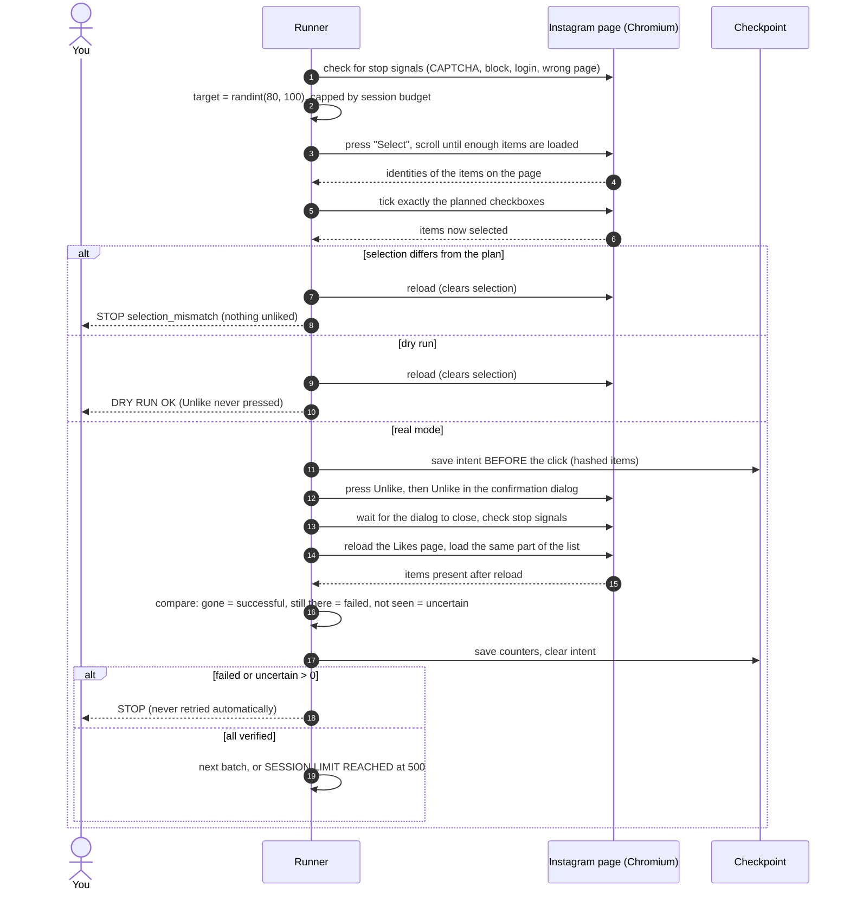
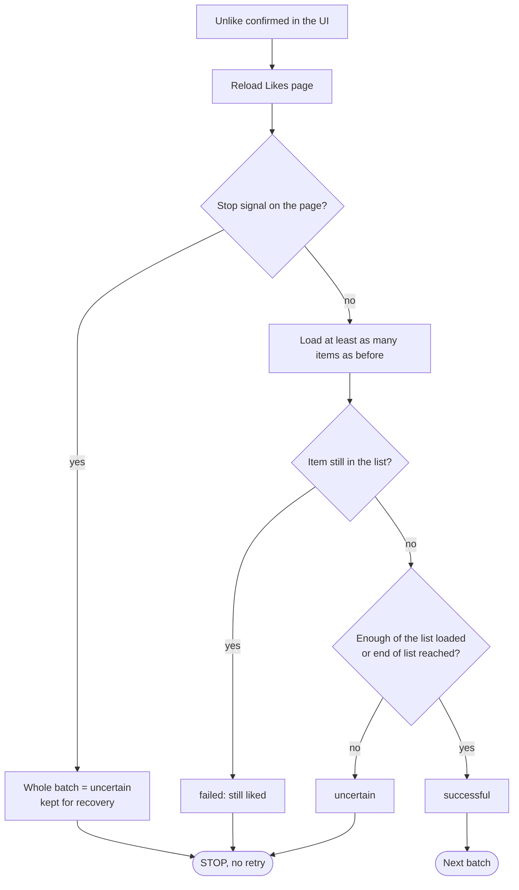
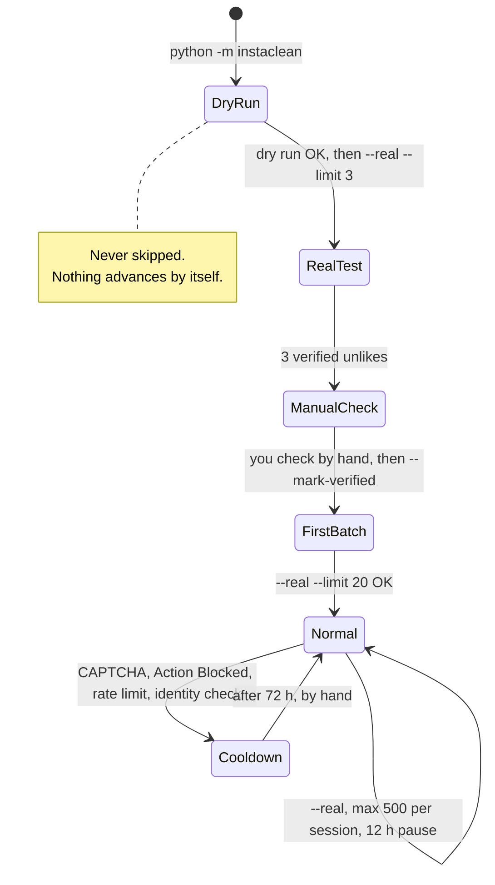
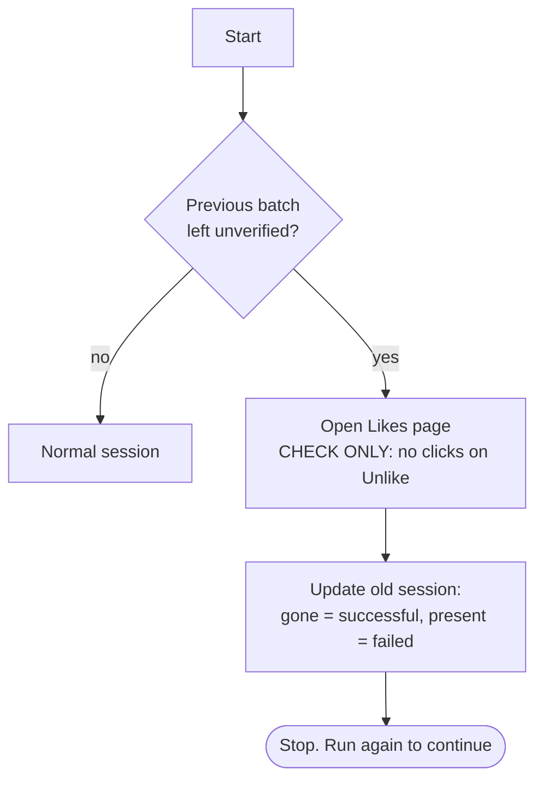
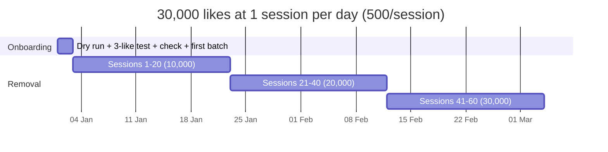
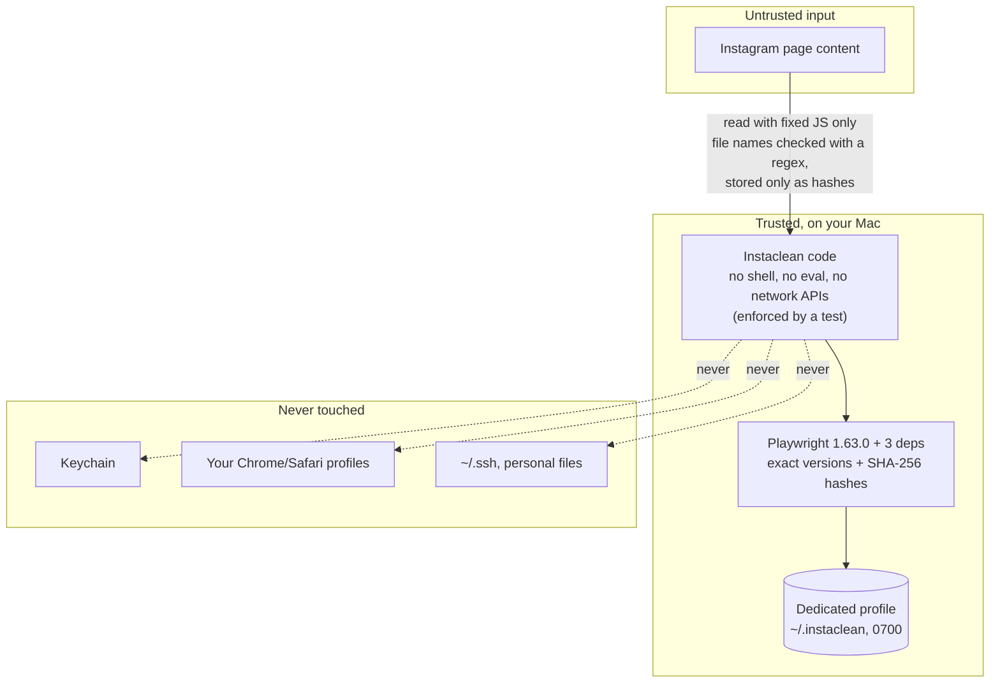

# Instaclean

**Remove your own Instagram likes in bulk, locally, through Instagram's normal web interface.**

Instaclean opens a visible Chromium window, lets *you* log in, goes to
*Your activity → Interactions → Likes*, selects a batch of liked posts, presses
**Unlike**, then reloads the page and **checks that every item is really gone**
before doing anything else. If something looks wrong, it stops.

[](#install)
[](#security-model)
[](#the-safe-path-five-steps)
[](LICENSE)

> Italian step-by-step guide: [docs/GUIDA-IT.md](docs/GUIDA-IT.md) ·
> Architecture: [docs/ARCHITECTURE.md](docs/ARCHITECTURE.md) ·
> Security: [docs/SECURITY.md](docs/SECURITY.md)

> [!WARNING]
> **No tool can promise your account will not be restricted.** Instagram does not
> publish its limits, and using automation can lead to temporary blocks or other
> restrictions. Instaclean does not try to look human or hide that it is
> automated. Its approach is to do less, verify everything and **stop at the first sign of trouble**.
> Use it on your own account, at your own risk.

---

## Contents

- [What it does and does not do](#what-it-does-and-does-not-do)
- [How it works](#how-it-works)
- [Install](#install)
- [The safe path: five steps](#the-safe-path-five-steps)
- [How long does it take? (e.g. 30,000 likes)](#how-long-does-it-take)
- [Account safety: what Instaclean does about blocks](#account-safety)
- [Security model](#security-model)
- [Configuration](#configuration)
- [Commands](#commands)
- [Troubleshooting](#troubleshooting)
- [Development and tests](#development-and-tests)
- [Known limitations](#known-limitations)

---

## What it does and does not do

| ✅ Does | ❌ Never does |
|---|---|
| Uses the normal Instagram website in a visible browser | Call private/internal Instagram APIs or send its own HTTP requests |
| Lets you log in and do 2FA by hand | Ask for, store or type your password |
| Keeps the session in a dedicated browser profile on your Mac | Read, export or log cookies/tokens; touch your Chrome/Safari profile or Keychain |
| Verifies every batch after a reload | Count a click as a success |
| Stops on CAPTCHA, Action Blocked, rate limits, login or identity checks | Solve CAPTCHAs, bypass limits, use "stealth" tricks or fake fingerprints |
| Pauses between sessions and after any block | Run in the background, schedule itself, or retry an uncertain unlike |
| Starts in **dry run** | Switch to real mode on its own |

---

## How it works

### Components


### One batch, step by step



### How a batch result is decided



### Stages: real mode is unlocked step by step



### Crash recovery



---

## Install

**Requirements:** macOS (Apple Silicon or Intel) · Python **3.11+** (tested with 3.14.6) ·
about 600 MB of disk for Playwright's Chromium · **no macOS permissions needed**
(no Accessibility, no Screen Recording, no Full Disk Access).

```bash
git clone https://github.com/Mr-Hodler/Instaclean.git
cd Instaclean

# 1. isolated environment (uv recommended: brew install uv)
uv venv .venv --python 3.14

# 2. dependencies, refused if any file differs from the reviewed hashes
uv pip install --python .venv/bin/python --require-hashes \
    -r requirements.lock -r requirements-dev.lock

# 3. Playwright's own Chromium (one-time download from Microsoft's CDN)
.venv/bin/playwright install chromium

# 4. check everything
.venv/bin/python -m instaclean --doctor
```

Without `uv`: `python3 -m venv .venv && .venv/bin/pip install --require-hashes -r requirements.lock -r requirements-dev.lock`.

`--doctor` only reads: Python version, virtualenv, package versions compared
with the lock file, the Chromium install, profile and folder permissions,
`.env`, `.gitignore`, stages and cooldown. It changes nothing.

---

## The safe path: five steps

| # | Command | What happens | Unlocks |
|---|---|---|---|
| 1 | `python -m instaclean` | **Dry run.** Log in by hand, navigate, select one batch, verify the selection, reload to cancel. **Unlike is never pressed.** | step 2 |
| 2 | set `INSTACLEAN_DRY_RUN=false` in `.env`, then `python -m instaclean --real --limit 3` | Type `UNLIKE` to confirm. Removes **3** likes and verifies them. | step 3 |
| 3 | check on your phone, then `python -m instaclean --mark-verified` | You confirm those 3 posts are no longer liked and nothing else changed. | step 4 |
| 4 | `python -m instaclean --real --limit 20` | First small batch. | step 5 |
| 5 | `python -m instaclean --real` | Normal mode: batches of 80–100, **max 500 per session**, then exits. | — |

(`python` = `.venv/bin/python`.) Real mode needs **two** switches: `INSTACLEAN_DRY_RUN=false`
in `.env` **and** `--real` on the command line. Either one alone gives you a dry run or a refusal.

---

## How long does it take?

**Short answer for 30,000 likes: about 60 sessions of 500, so roughly one to two months on
the calendar, and 10–15 hours of the program actually running.** What limits it is the
pacing between sessions, not how fast the clicks are.

### The numbers

| Quantity | Value | Notes |
|---|---|---|
| Likes per session | 500 (default cap) | `INSTACLEAN_MAX_ACTIONS_PER_SESSION` |
| Batches per session | ~6 | 80–100 each |
| Time per batch | ~1.5–2.5 min | measured on a real account (dry run, 2026-10-18): loading 99 likes ≈ 13 s, ticking 93 checkboxes ≈ 29 s; confirm + reload + verification estimated |
| Time per session (estimate) | ~10–15 min | |
| Minimum pause between sessions | 12 h | enforced; `INSTACLEAN_MIN_HOURS_BETWEEN_SESSIONS` |
| Pause after any block signal | 72 h | enforced; `INSTACLEAN_BLOCK_COOLDOWN_HOURS` |

### 30,000 likes in practice

| Pace | Sessions/day | Likes/day | Calendar time | Program running |
|---|---|---|---|---|
| Fastest the defaults allow | 2 | 1,000 | **~30 days** | ~10–15 h total |
| Recommended | 1 | 500 | **~60 days** | ~10–15 h total |
| Very conservative (`MAX_ACTIONS=300`) | 1 | 300 | **~100 days** | ~10–15 h total |
| With a block or two along the way | — | — | add 3 days per block | — |



Loading and selection times were measured in a real dry run; the Unlike + verification part
is still estimated until the first real batches. Your own logs have timestamps to recompute. Know your real total
first: Instagram → *Accounts Center → Your information and permissions → Download your
information* lists your liked posts.

> Ten years of likes may not all show up on the web Likes page. If Instaclean
> reports `empty_unconfirmed` or `completed` while the export still lists likes,
> those older likes are simply not exposed there. Instaclean cannot reach them,
> and it does not go around the UI to get them.

---

## Account safety

Instagram decides what counts as abuse, and it does not publish the thresholds.
Instaclean cannot guarantee you won't be blocked, restricted or shadow-banned.
It does not try to disguise itself. What it does is keep the volume low and react
to every warning:

| Measure | How it is enforced |
|---|---|
| **Low volume per run** | 500 unlikes per session by default; batches never above 100 (hard cap in code) |
| **Pause between sessions** | Real mode is refused for 12 h after a full-size session |
| **Stop at the first warning** | CAPTCHA, *Action Blocked*, *Try again later*, "we limit how often", identity checks, "automated behaviour" warnings, forced login, unknown errors, unexpected pages |
| **Long cooldown after a warning** | Real mode is refused for 72 h after any of the above |
| **No retries of destructive actions** | An uncertain unlike is checked later; it is never clicked again automatically |
| **One session at a time** | One dedicated profile; Chromium refuses a second instance on it |
| **Visible browser** | Every action happens in front of you; you can close the window at any moment (`browser_disconnected` → stop) |
| **Normal UI only** | The same bulk "Select → Unlike" that Instagram offers to every user |

**If Instagram shows a warning:**
1. Let Instaclean stop. Do not run it again.
2. Complete any check Instagram asks for **yourself**, in the app.
3. Wait at least the cooldown (72 h). Waiting longer is better.
4. Start again with a smaller `INSTACLEAN_MAX_ACTIONS_PER_SESSION`, for example 200.

**Also on your side:** keep 2FA on, don't run other automation on the same account,
and don't use Instaclean on accounts that aren't yours.

---

## Security model



| Threat | Mitigation |
|---|---|
| Malicious or compromised dependency | One runtime dependency (Microsoft Playwright) and its 3 sub-deps, pinned with hashes; installed with `--require-hashes`; `pip-audit` clean on 2026-10-18 |
| Secrets committed to Git | Profile lives **outside** the repo; `.gitignore` covers `.env`, logs, checkpoints, debug, profiles, HAR/trace files; a test checks the ignore rules |
| Session theft from disk | Profile `0700`, checkpoints `0600`, logs dir `0700`. Note: Playwright's Chromium uses a mock keychain, so anyone who can read the profile folder has your session. Delete it when finished |
| Using your personal browser | Refused: profile paths inside `~/Library/Application Support`, `~/.ssh`, Keychains… are rejected |
| Page content steering the code | DOM is read by fixed scripts; identities must match `^[\w.\-]{6,200}$`; click targets are tagged by Instaclean and stale tags are wiped on each scan; Playwright strict mode refuses ambiguous clicks |
| Navigation to another site | Any host other than `instagram.com` is a stop condition; downloads are disabled |
| Telemetry / data leaving the Mac | None in Instaclean; the Playwright driver was inspected and has no telemetry; tests block every network request |
| Code drifting into risky APIs | `tests/test_security_static.py` fails on `subprocess`, `socket`, `requests`, `eval`, `exec`, `os.system`, `cookies()`, `storage_state()`, internal API URLs |

**Delete everything Instaclean stored:**
```bash
rm -rf ~/.instaclean            # browser profile = your Instagram session on this Mac
rm -rf checkpoints logs debug   # local run data
```
Then on Instagram: *Settings → Accounts Center → Password and security → Where you're logged in* → log out that session.

Details: [docs/SECURITY.md](docs/SECURITY.md).

---

## Configuration

Copy `.env.example` to `.env` (gitignored). **Never put a password, cookie or token there.**

| Variable | Default | Meaning |
|---|---|---|
| `INSTACLEAN_DRY_RUN` | `true` | must be `false` **and** `--real` passed for real unlikes |
| `INSTACLEAN_BATCH_MIN` / `INSTACLEAN_BATCH_MAX` | `80` / `100` | random batch size range; 100 is a hard cap in code |
| `INSTACLEAN_MAX_ACTIONS_PER_SESSION` | `500` | unlikes per run (a local limit, not an Instagram number) |
| `INSTACLEAN_INITIAL_TEST_SIZE` | `3` | size of the first real test |
| `INSTACLEAN_MIN_HOURS_BETWEEN_SESSIONS` | `12` | enforced pause after a full-size real session |
| `INSTACLEAN_BLOCK_COOLDOWN_HOURS` | `72` | enforced pause after any block/limit/CAPTCHA/identity stop |
| `INSTACLEAN_VERIFY_RECHECK_SECONDS` / `INSTACLEAN_VERIFY_RECHECKS` | `45` / `2` | Instagram applies bulk unlikes asynchronously: items still listed after the reload are re-checked (read-only) this many times before counting as failed |
| `INSTACLEAN_ALLOW_UNATTENDED` | `false` | allows `--real --unattended` (no UNLIKE prompt) for scheduled **normal** sessions only, after all stages; pauses, cooldowns and stops still apply |
| `INSTACLEAN_DEBUG` | `false` | save screenshots + HTML to `debug/` (may show thumbnails of liked posts) |
| `INSTACLEAN_PROFILE_DIR` | `~/.instaclean/browser-profile` | dedicated Chromium profile |

The batch size is random within 80–100 only so that each run is not one fixed number. It
is **not** meant to evade detection and it will not.

---

## Commands

```bash
.venv/bin/python -m instaclean                     # dry run
.venv/bin/python -m instaclean --real --limit 3    # first real test
.venv/bin/python -m instaclean --mark-verified     # after checking by hand
.venv/bin/python -m instaclean --real --limit 20   # first small batch
.venv/bin/python -m instaclean --real              # normal session
.venv/bin/python -m instaclean --real --unattended # scheduled normal session (opt-in in .env)
.venv/bin/python -m instaclean --status            # stages, last session, cooldowns
.venv/bin/python -m instaclean --doctor            # environment check
.venv/bin/python -m instaclean --debug ...         # + screenshots/HTML on stop
```

| Exit code | Meaning |
|---|---|
| 0 | dry run OK · completed · session limit reached · recovery done |
| 2 | stopped (stop condition, stage gate, cooldown, refused) |
| 3 | uncertain result: nothing retried, check with the next run |
| 4 | no likes and no *Select* control: check by hand |
| 1 | configuration or internal error |

---

## Troubleshooting

| Message | What to do |
|---|---|
| `stage_gate` | Run the step named in the message |
| `cooldown` | Wait until the time shown (`--status`) |
| `Real mode refused` | Set `INSTACLEAN_DRY_RUN=false` in `.env` **and** pass `--real` |
| `selector_failure`, "Menu navigation failed" | Instagram changed its layout or your language isn't covered. Run with `--debug`, look at `Diagnostics:` in `logs/`, adjust `instaclean/selectors.py` |
| `selection_mismatch` | Instagram may cap how many items can be selected. Lower `INSTACLEAN_BATCH_MAX` |
| `verification_failed` | Some items were still listed after the re-checks. The batch stays pending: the next run re-checks it read-only before doing anything else (Instagram is often just slow) |
| `uncertain_result` | Run again: the next run only **checks** the batch, it doesn't click |
| `action_blocked`, `rate_limit`, `captcha`, `identity_verification`, `security_warning` | See [Account safety](#account-safety). Wait, don't retry |
| `empty_unconfirmed` | No likes visible. Confirm by hand / with the data export |
| Login window keeps reappearing | Log in again in the Instaclean window; the session is stored only in its profile |

---

## Development and tests

```bash
.venv/bin/python -m pytest -q                    # everything (~50 s)
.venv/bin/python -m pytest -q -m "not browser"   # pure logic only (<1 s)
.venv/bin/pip-audit --strict --require-hashes --disable-pip -r requirements.lock -r requirements-dev.lock
```

| Kind | What is covered |
|---|---|
| **Automated** | batch range 80–100, hard cap 100, session limit, fewer than 80 left, empty list, dry run, stage gate, real-mode confirmation, selection mismatch, verification failure, uncertain results, every stop condition, cooldowns, checkpoints (atomic, 0600, no personal data, corruption), crash recovery, `--doctor`, static security scan, `.gitignore` coverage |
| **Automated, mock DOM** | The real Playwright layer driven against a local imitation of the Likes page (network blocked): menu navigation, infinite scroll, select, unlike, verification, Action Blocked + recovery, CAPTCHA frame, closed browser |
| **Manual (required)** | Anything about the real instagram.com: the five steps above |

The mock DOM shows the code works. It **does not** show that the selectors match
Instagram's real markup; only the dry run on your account can confirm that.

Project layout:

```
instaclean/   config · errors · batch · verifier · checkpoint · safety · selectors
              runner · browser · instagram · doctor · main
tests/        unit tests, fakes, mock Instagram page, security checks
docs/         ARCHITECTURE.md · SECURITY.md · GUIDA-IT.md
```

---

## Known limitations

- Selectors come from the public web UI and **must be confirmed by your first dry run**. Instagram changes its markup.
- UI text recognised in English, Italian, Spanish, French, German, Portuguese, Dutch.
  Add other languages in `selectors.py` and `safety.py`.
- An item is identified by its thumbnail's file name on Instagram's CDN. If that ever
  changes, verification fails safely (stop).
- Verification assumes the list is newest-first. Liking new posts during a run can make
  results `uncertain` (stop).
- Old likes that the web page does not show cannot be removed with Instaclean.
- Stop detection reads URLs, frames and visible text. A warning in a new format might be missed;
  that is why the browser always stays visible.

## License

[MIT](LICENSE). Not affiliated with, endorsed by or connected to Instagram or Meta.
